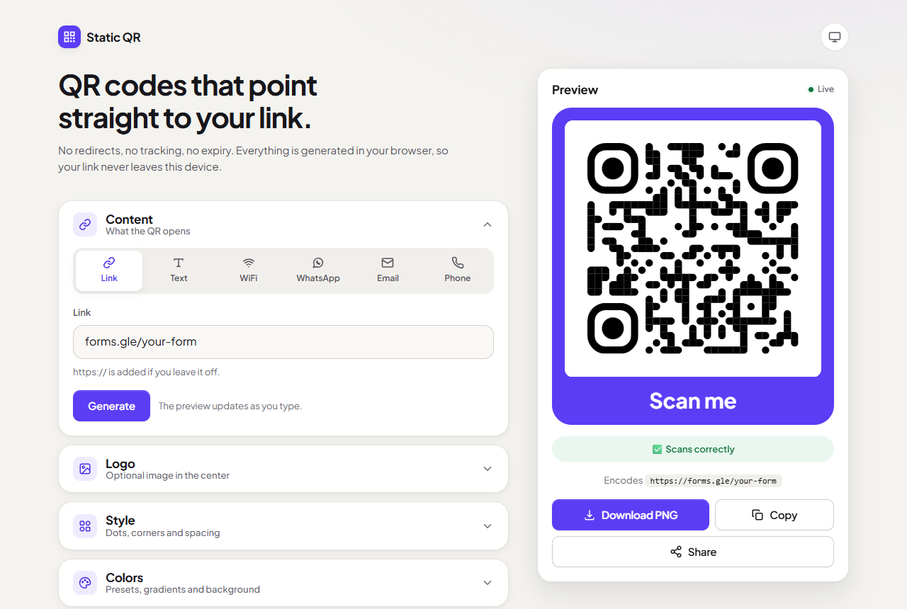
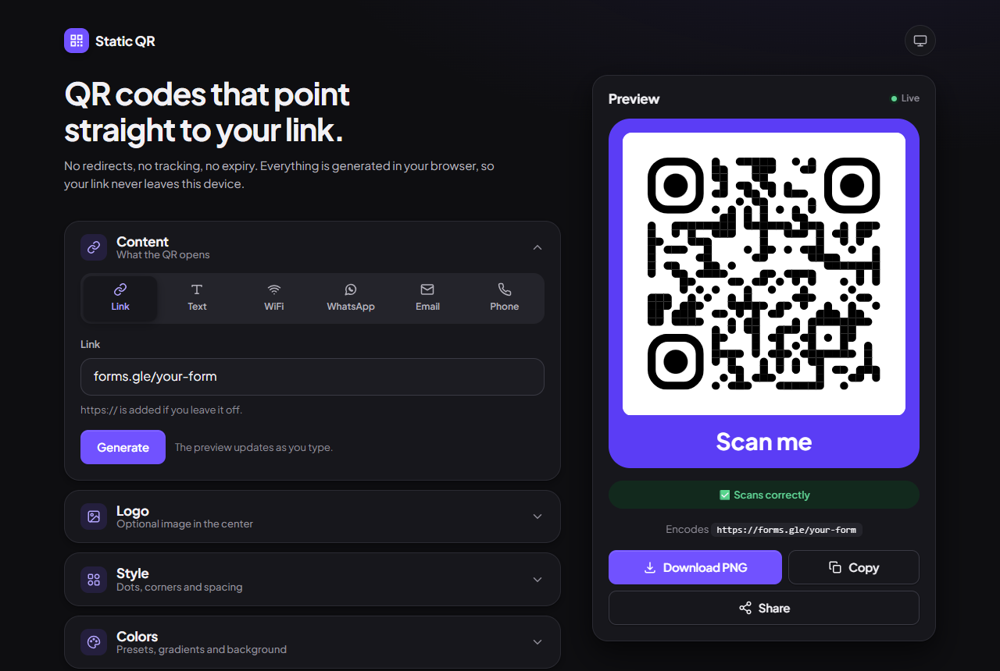

# Static QR Generator

A small, ad-free QR code generator that runs entirely in your browser.

**Live demo:** https://your-project.vercel.app <!-- TODO: replace with your Vercel URL after deploying -->

| Light | Dark |
| --- | --- |
|  |  |

## Why this exists

Many "free" QR websites make **dynamic** QR codes. The QR doesn't contain your link. It contains a link to *their* redirect server, which then forwards people to you. That lets them add ad pages, tracking, or paywalls later, and the QR breaks if they shut down.

This tool makes **static** QR codes only:

- The QR encodes **exactly** the link you type. Nothing is added or wrapped.
- Generation happens **client-side** with [`qr-code-styling`](https://www.npmjs.com/package/qr-code-styling). There's no backend, no API calls, and no database, so your data never leaves your device.
- No ads, popups, cookie banners, or analytics.

You can confirm a QR is static: scan it and check that the link shown is your own URL, not some `qr-xyz.com/abc` short link.

## Features

- **Live preview** that updates as you type, plus a **Generate** button (or Enter)
- **QR types:** link, plain text, WiFi (`WIFI:` format with special characters escaped), WhatsApp (`wa.me`; Pakistani `03xx` numbers become `923xx`), email (`mailto:`) and phone (`tel:`)
- Shows the exact encoded text under the QR so you can verify it (WiFi passwords are masked)
- **Logo** in the center (upload or drag & drop). Error correction switches to H automatically
- **Styles:** dot and corner shapes, 8 color presets, gradients, separate corner color, transparent background, margin
- **Frame** with a label such as "Scan me", included in every download format
- **Export** as PNG, SVG, JPEG or WEBP at 512, 1024 or 2048 px. **Copy** the image to the clipboard, or **Share** the PNG file on phones
- **Scan check:** every QR is decoded in your browser with [`jsQR`](https://www.npmjs.com/package/jsqr), at full size and as a small, blurred copy that imitates a phone camera
- Warnings for low contrast, thin margins and very dense codes
- **Recent:** your last 5 QR codes, stored only in this browser. WiFi passwords and full logos are never saved
- Light and dark mode (follows your system, or pick one), keyboard accessible, respects reduced motion

## Run locally

Requires [Node.js](https://nodejs.org/) 20.19+ or 22.12+.

```bash
npm install
npm run dev
```

Open the URL Vite prints (usually http://localhost:5173).

To build and preview the production version:

```bash
npm run build
npm run preview
```

## Tests

```bash
npm test
```

Fast unit tests (Node's built-in test runner, no extra packages) for the parts that are easy to get subtly wrong:

- QR text builders: WiFi escaping, WhatsApp number cleanup, email/phone links, URL handling
- UTF-8 encoding, so Urdu and emoji scan correctly
- Contrast check and color presets
- Recent history: WiFi passwords are never stored, storage-full handling

## Deploy to Vercel

No configuration file is needed. Vercel detects Vite automatically.

1. **Push this project to GitHub** (create a new repo and push your code).
2. Go to [vercel.com](https://vercel.com), sign in with GitHub, and click **Add New… → Project**.
3. Find your repository in the list and click **Import**.
4. Vercel should pre-fill these settings (leave them as they are):
   - Framework Preset: **Vite**
   - Build Command: `npm run build`
   - Output Directory: `dist`
5. Click **Deploy**. After about a minute you'll get a live URL like `your-project.vercel.app`.

Every later `git push` to the main branch redeploys automatically.

**Link previews:** when you share the site on WhatsApp or LinkedIn it shows `public/og-image.png`. Those apps need the image's full address, so `vite.config.js` fills in your site URL at build time. On Vercel this is automatic. If you add a custom domain, set an environment variable `SITE_URL` (for example `https://qr.example.com`) in the Vercel project settings.

## Project structure

```
├── index.html          # Page markup
├── src/
│   ├── main.js         # Connects the controls to everything below
│   ├── state.js        # All settings in one object, plus defaults
│   ├── content.js      # Builds the text for each QR type, with validation
│   ├── qr.js           # Draws the QR with qr-code-styling
│   ├── logo.js         # Reads and prepares the uploaded logo
│   ├── export.js       # Frame + label, downloads, copy, share
│   ├── verify.js       # jsQR scan check (clean and degraded)
│   ├── history.js      # Recent QRs in localStorage (no passwords)
│   ├── color.js        # Contrast check
│   ├── presets.js      # Color themes
│   ├── storage.js      # Safe localStorage wrappers
│   ├── ui.js           # Panels, toasts, theme toggle
│   ├── encoding.js     # UTF-8 conversion for the QR library
│   └── styles/         # tokens.css (colors, spacing), base, layout, components
├── test/               # Unit tests (npm test)
├── public/             # favicon, og-image.png, apple-touch-icon.png, robots.txt
├── docs/               # README screenshots
├── vite.config.js      # Fills in the site URL for link previews
└── package.json        # Pinned dependency versions
```
